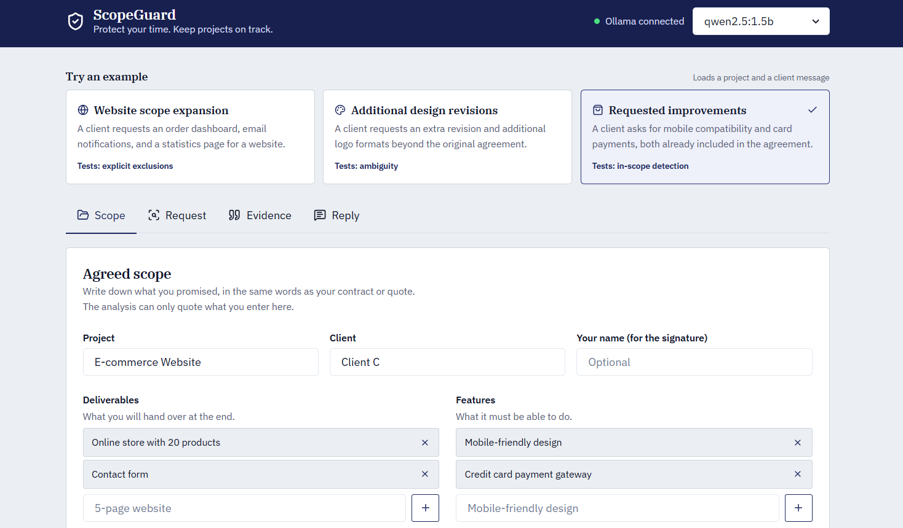
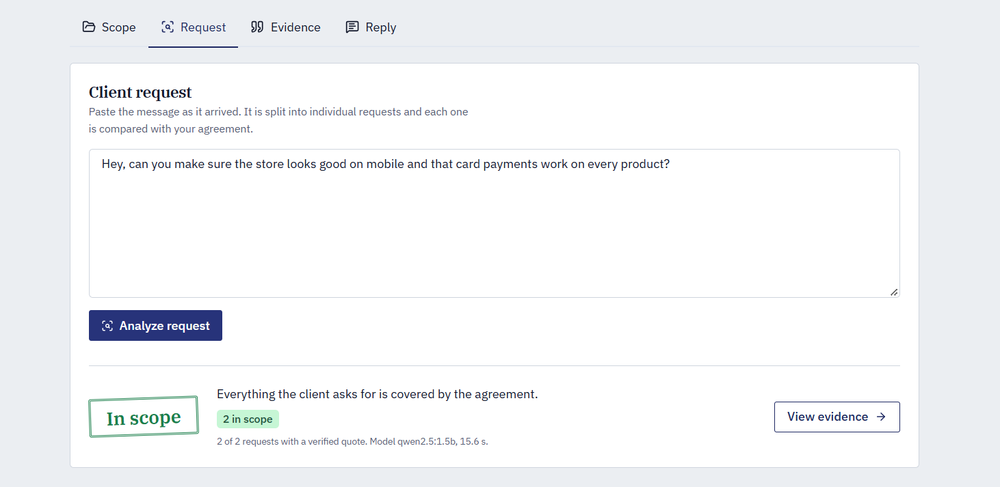
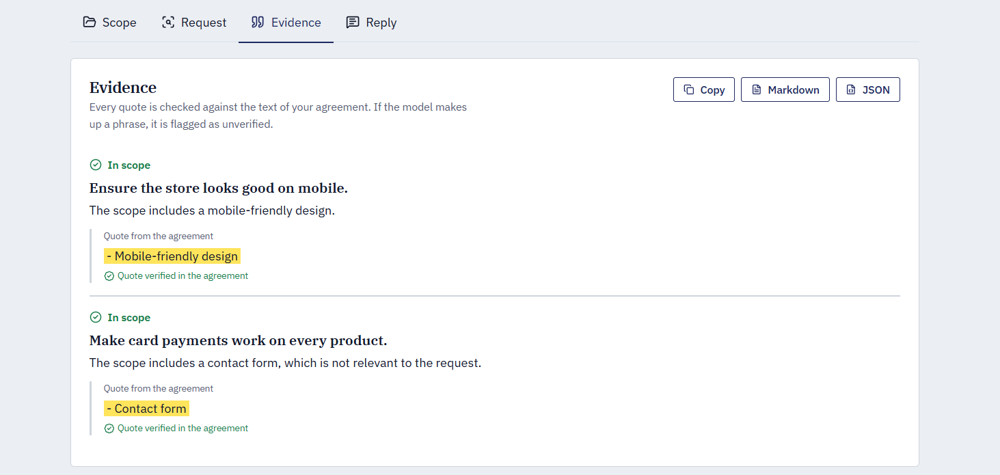
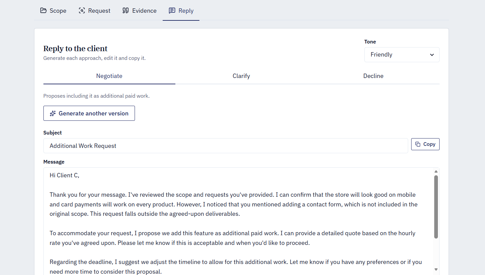

# ScopeGuard

ScopeGuard is a web tool for freelancers, developers, and designers that compares new client requests against the agreed project scope, presents evidence through verified quotes from the agreement, and helps draft professional replies to negotiate additional work, ask for clarification, or decline a request.

**ScopeGuard uses open-weight language models locally through Ollama by default.**

## Screenshots

### Project Scope

Define the agreed deliverables, features, and project boundaries.



### Request Analysis

Submit a new client request and compare it against the original scope.



### Evidence and Gaps

Review supporting quotes, potential scope additions, and ambiguous requirements.



### Reply Generator

Generate a professional response to negotiate additional work, request clarification, or decline a request.



## Features

- **Scope comparison:** Analyze individual parts of a client request against agreed deliverables.
- **Evidence-backed analysis:** Verify supporting quotes against the original scope text.
- **Ambiguity detection:** Flag missing information and uncertain conclusions.
- **Professional replies:** Draft responses using different approaches and tones.
- **Local AI inference:** Run open-weight language models through Ollama.
- **Model selection:** Switch between installed models if supported by the current implementation.
- **Structured output:** Validate model responses using Pydantic schemas and application-level checks.
- **Browser storage:** Keep saved project data in the browser using `localStorage`, without requiring a database server.

## Why Open Models Matter

- **Privacy:** When the frontend, backend, and model runtime operate locally, project agreements and client messages can remain on the user's machine.
- **Cost control:** No per-request fees from an external LLM API, although local hardware and electricity still have costs.
- **No provider lock-in:** Use compatible locally installed models through Ollama.
- **Offline potential:** Inference can work without an internet connection once the model and application dependencies are available locally.
- **Transparency and control:** Application-level validation helps reduce unsupported claims instead of relying entirely on the model's output.

## Tech Stack

- **Frontend:** React, Vite, TypeScript, Chakra UI v2, lucide-react
- **Backend:** FastAPI, Python, httpx, Pydantic
- **AI runtime:** Ollama
- **Default model:** Qwen2.5 3B
- **Browser persistence:** `localStorage`

## How It Works

1. **Define the project scope:** Enter the agreed deliverables, features, and limitations.
2. **Submit a client request:** Paste the new request or proposed change.
3. **Analyze the request:** The model evaluates individual request items against the supplied scope.
4. **Review the evidence:** Supporting quotes are checked against the original scope text.
5. **Choose a response approach:** Generate a reply to negotiate an add-on, ask for clarification, or decline.

### Hallucination Safeguards

Small language models can produce incorrect or unsupported claims. ScopeGuard combines model output with application-level validation to help reduce these errors.

1. **Request decomposition:** Evaluate individual parts of a client request separately.
2. **Structured output:** Use Pydantic schemas to define the expected response structure.
3. **Evidence verification:** Check whether a supporting quote appears in the agreement text, ignoring case, accents, and punctuation.
4. **Conservative classification:** If a claimed in-scope item lacks valid supporting evidence, downgrade it to an ambiguous result.
5. **Code-based verdicts:** Calculate the final classification in application code rather than trusting the model's verdict alone.

These safeguards reduce the risk of unsupported conclusions but do not eliminate hallucinations. Users should review the analysis before relying on it in client negotiations.

## Quick Start

### Prerequisites

- Python 3.12 or a compatible supported version
- Node.js and npm
- Ollama

### 1. Install Ollama and Download the Model

Install Ollama from [ollama.com](https://ollama.com), then run:

```bash
ollama pull qwen2.5:3b
```

### 2. Start the Backend

```bash
cd backend
python -m venv .venv
```

Activate the virtual environment.

**Windows PowerShell:**

```powershell
.venv\Scripts\Activate.ps1
```

**Linux or macOS:**

```bash
source .venv/bin/activate
```

Install dependencies and start FastAPI:

```bash
pip install -r requirements.txt
uvicorn app.main:app --port 8000 --reload
```

### 3. Start the Frontend

Open a second terminal:

```bash
cd frontend
npm install
npm run dev
```

Open the local URL printed by Vite, usually `http://localhost:5173`.

Use **Load example** in the header to explore the application with sample data, if available.

## Switching Models

ScopeGuard uses `qwen2.5:3b` by default.

If model configuration is supported by your implementation, configure `MODEL_NAME` in the backend environment or select another installed Ollama model from the interface.

To list installed models:

```bash
ollama list
```

## API Reference

| Method | Endpoint | Description |
|---|---|---|
| `GET` | `/api/health` | Check backend and Ollama status |
| `POST` | `/api/analyze` | Compare a project scope against a client request |
| `POST` | `/api/respond` | Generate a professional response |

The exact request and response schemas depend on the current implementation.

## Data Storage and Privacy

ScopeGuard uses browser `localStorage` to persist saved data between browser sessions on the same browser and origin.

- Data is not automatically synchronized across devices.
- Clearing browser storage or site data may delete saved projects.
- Browser storage is not encrypted by default. Avoid storing sensitive contracts or client information on shared devices.
- Analysis requests are sent to the configured backend and Ollama runtime. Keep these services local if you want to avoid sending project information to external services.

## Limitations

- Analysis quality depends on the selected model and the clarity of the supplied scope.
- Missing evidence does not necessarily mean a request is out of scope.
- ScopeGuard does not determine legal liability or replace contract review.
- Local inference requires sufficient memory and computing resources.
- Generated replies should be reviewed before being sent to clients.